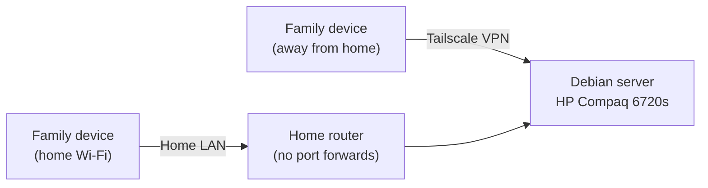

# Secure Home Server on a 2008 Laptop

Turning an old HP Compaq 6720s into a hardened, VPN-only Debian server for my family. A hands-on project covering Linux administration, SSH hardening, VPN access, host firewalling and security auditing.

> **Status:** work in progress · **Last updated:** November 2026

## Why this project

- Give old hardware a useful second life instead of letting it gather dust.
- Practice real security fundamentals on a system I fully control: least privilege, key-only authentication, default-deny networking, patching and auditing.
- Provide simple services for a non-technical family (ad blocking, shared files, a one-page "Family Hub").
- Document everything the way a professional write-up would, so someone else could reproduce and review it.

## Skills demonstrated

Linux server administration (Debian) · SSH key authentication and hardening · VPN design (Tailscale, WireGuard-based) · host firewall rules (`ufw`) · patch management · security auditing (Lynis) · technical documentation

## Hardware and OS

| | |
|---|---|
| Machine | HP Compaq 6720s (2008-era laptop) |
| CPU | Intel Core 2 Duo T7250 |
| RAM | ~3 GB |
| Storage | 2.5" SATA hard drive |
| Network | Wired Ethernet |
| OS | Debian 13 "Trixie" (amd64), CLI-only install: SSH server + standard system utilities |

**Why Debian CLI instead of Kali?** I first ran Kali (Xfce desktop plus a heavy terminal UI) on this laptop. Both CPU cores sat near 100% and it was too laggy to use. A server doesn't need a desktop: a minimal Debian install idles on a fraction of the resources and exposes less software to attack.

## Architecture

## Security design (target state)

| Control | Implementation |
|---|---|
| Remote access | Tailscale (WireGuard-based VPN); **no router port forwarding** |
| Authentication | SSH keys only (Ed25519); password login and root login disabled |
| Host firewall | `ufw` default-deny inbound; SSH allowed only on the `tailscale0` interface |
| Patching | `unattended-upgrades` for automatic security updates |
| Addressing | DHCP reservation on the router instead of a hand-edited static IP |
| Verification | Lynis audit, before and after hardening |

## Progress

- [x] Install Debian 13 (netinst, CLI-only)
- [x] Reserve a DHCP address for the server on the router
- [x] SSH key login from my main laptop
- [x] Tailscale working from outside the home network (tested on a phone hotspot)
- [ ] Disable SSH password and root login
- [ ] Keep running with the lid closed
- [ ] `ufw` default-deny with Tailscale-only SSH
- [ ] Lynis audit (before and after)
- [ ] "Family Hub" page (nginx + Homer)
- [ ] Network-wide DNS filtering (AdGuard Home)
- [ ] Family file sharing
- [ ] Forward logs to a SIEM (Wazuh or Splunk)

## Results

| Check                         | Before hardening | After hardening |
| ----------------------------- | ---------------- | --------------- |
| Lynis hardening index         | 66 / 100         | TODO            |
| Listening ports (`ss -tulpn`) | TODO             | TODO            |
| SSH password authentication   | TODO             | TODO            |

Screenshots and command output are in [`screenshots/`](screenshots/).

## Documentation

1. [Hardware and OS choice](docs/01-hardware-and-os.md)
2. [Installing Debian (CLI-only)](docs/02-install-debian.md)
3. [SSH hardening](docs/03-ssh-hardening.md)
4. [Tailscale VPN](docs/04-tailscale.md)
5. [Firewall with ufw](docs/05-firewall.md)
6. [Lynis audit](docs/06-lynis-audit.md)
7. [Troubleshooting](docs/troubleshooting.md)

## Problems I hit and how I solved them

- **Installer: "No network mirror was selected."** Answering *No* returns to mirror selection. With Ethernet connected, picking a mirror lets the installer download the full system instead of stopping at a minimal base.
- **Software-selection screen jumped ahead.** In this installer, **Space** ticks a box and **Enter** presses *Continue*, so pressing Enter on a highlighted desktop environment moved on with it still selected. Fix: untick desktops with Space, tick only *SSH server* and *standard system utilities*, then Tab to *Continue*.
- **"REMOTE HOST IDENTIFICATION HAS CHANGED!" after reinstalling.** Expected, since the reinstall generated new SSH host keys while my laptop remembered the old one. Instead of blindly deleting the entry, I compared the fingerprint on the server's own console (`ssh-keygen -lf /etc/ssh/ssh_host_ed25519_key.pub`) with the one in the warning, then removed the stale entry with `ssh-keygen -R <server-lan-ip>`.

## Lessons learned

- TODO: what surprised me
- TODO: what I would do differently

## Roadmap

- [ ] Home SIEM receiving this server's logs (detections mapped to MITRE ATT&CK)
- [ ] Scheduled Nmap scan of my own network with change alerts
- [ ] Web application security write-up (OWASP Juice Shop, then my own app)

## Privacy note

Private IP addresses, hostnames, usernames, MAC addresses and keys are intentionally redacted or replaced with placeholders such as `<server-lan-ip>` and `<tailscale-ip>`.

## License

MIT
