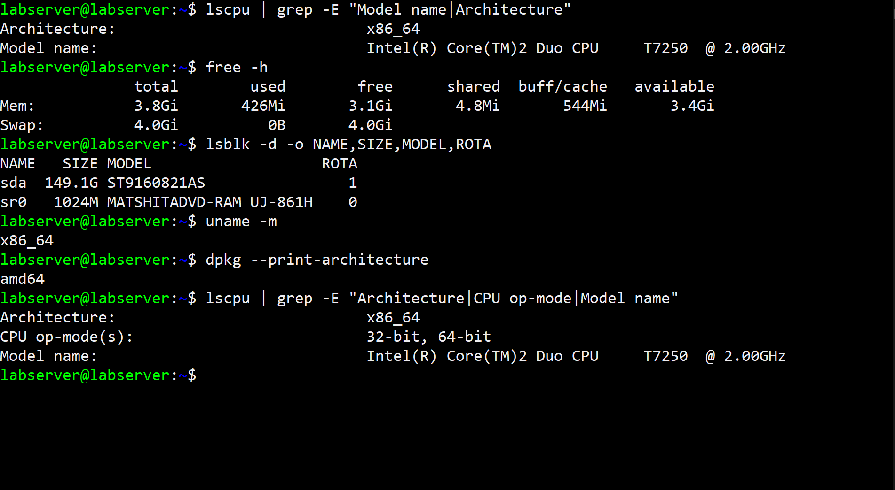
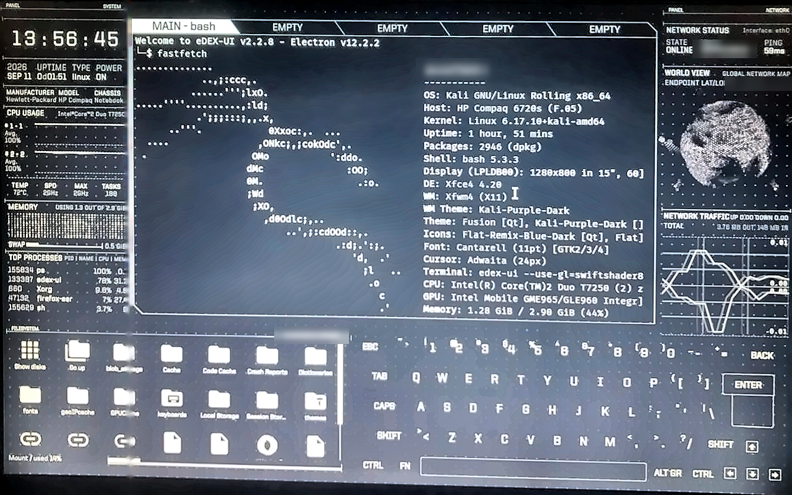
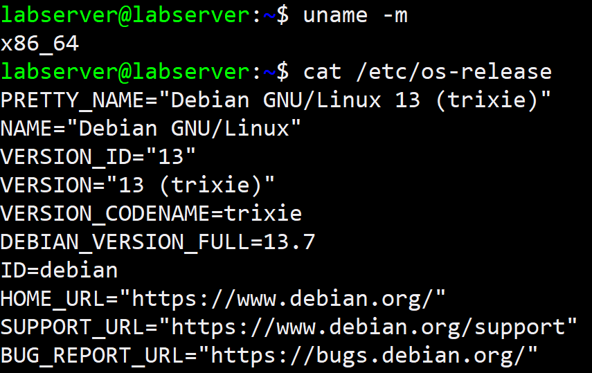

# 01 – Hardware and OS choice

**Goal:** choose an operating system that turns a 2008 laptop into a small, secure, always-on server.

**Why:** a server should be small, patched and boring. Every extra package (desktop, browser, GUI tools) is more code to patch and more attack surface.

## Hardware

|         |                        |
| ------- | ---------------------- |
| Machine | HP Compaq 6720s        |
| CPU     | Intel Core 2 Duo T7250 |
| RAM     | ~4 GB                  |
| Storage | 2.5" SATA hard drive   |
| Network | Wired Ethernet         |

Commands used to collect this:

```bash
lscpu | grep -E "Model name|Architecture"
free -h
lsblk -d -o NAME,SIZE,MODEL,ROTA
uname -m
dpkg --print-architecture
lscpu | grep -E "Architecture|CPU op-mode|Model name"
```

> 

## First attempt: Kali Linux

I first installed Kali (Xfce desktop plus a heavy Electron-based terminal UI). The laptop was too laggy to use: both CPU cores sat near 100% and about 1.3 GB of the 2.9 GB RAM was in use. Kali is also an offensive-security toolkit, not a server OS. Side note: because the 64-bit Kali image ran, the CPU is 64-bit capable.

| Metric     | Kali (desktop)                                        | Debian CLI (after install)                    |
| ---------- | ----------------------------------------------------- | --------------------------------------------- |
| CPU load   | both cores near 100%                                  | 0.7% idle or 1 connected device to the server |
| RAM in use | ~1.3 GB of 2.9 GB (Before Adding a new 2GB RAM stick) | 207 MB of 3.8 GB                              |

>

## Options considered

| Option | Fit | Decision |
|---|---|---|
| Kali Linux (desktop) | Heavy, tool-focused, not meant for servers | Rejected |
| Debian 13 "Trixie" (amd64), CLI-only | Current stable release, supported for years, tiny footprint | **Chosen** |
| Debian 12 (i386) | Only needed for 32-bit-only CPUs; long-term support ends in 2028 | Not needed |
| antiX 26.1 Core | Even lighter, but unnecessary on a 64-bit CPU that runs Debian CLI comfortably | Not needed |

## Decision

Debian 13 (amd64), minimal CLI install: server skills that transfer to real jobs, security updates for years, and low idle resource use.

## Verify

```bash
uname -m              # expect: x86_64
cat /etc/os-release   # expect: Debian GNU/Linux 13 (trixie)
```

>

## What I'd do differently

> **TODO:** one or two lines.
