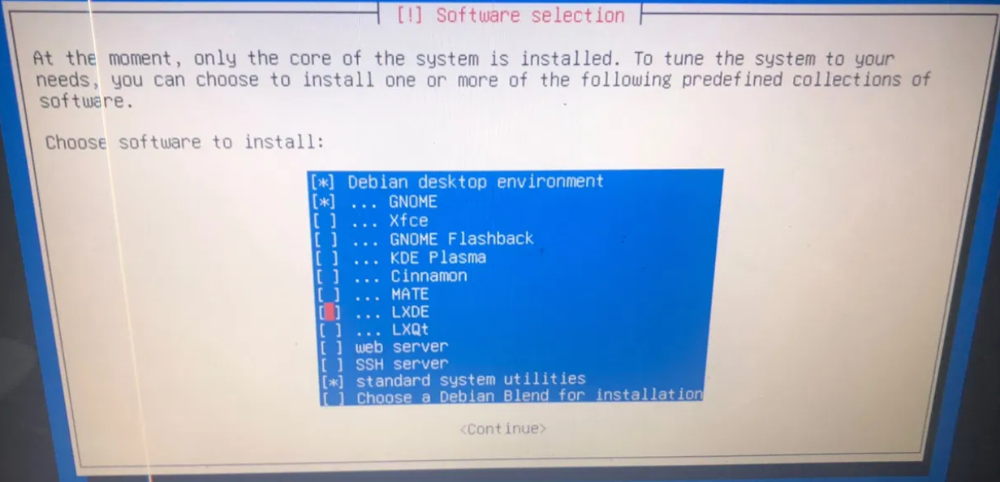
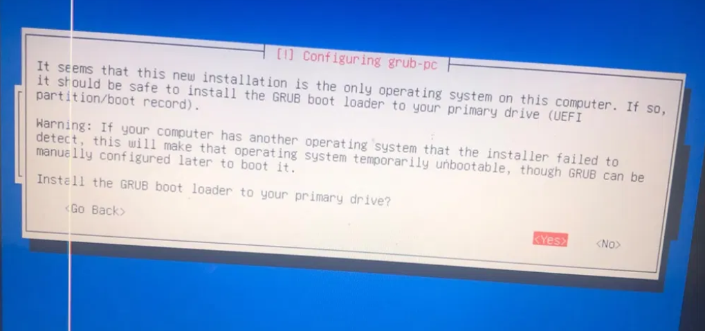
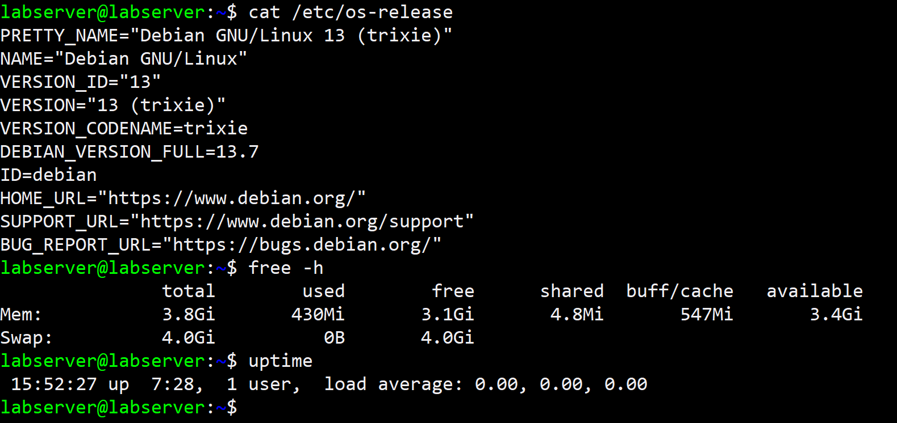

# 02 – Installing Debian (CLI-only)

**Goal:** a minimal Debian 13 install with only an SSH server and standard utilities.

**Why:** no desktop means less RAM use, less software to patch and fewer ways in.

## 1. Get and verify the installer

Download the 64-bit PC (amd64) **netinst** ISO from debian.org, plus `SHA512SUMS` from the same page. Verify it in PowerShell (use your own filename):

```powershell
$expected = ((Get-Content .\SHA512SUMS | Select-String "debian-13.x.0-amd64-netinst.iso$").Line -split '\s+')[0]
$actual = (Get-FileHash .\debian-13.x.0-amd64-netinst.iso -Algorithm SHA512).Hash
$expected -eq $actual    # expect: True
```

Write the ISO to a USB stick with balenaEtcher (Rufus users: choose DD Image mode).

> **TODO (evidence):** `screenshots/03-iso-checksum-match.png`.

## 2. Boot the laptop from USB

On the HP, press **Esc** for the startup menu, then **F9** for boot options, and pick the USB drive. Connect Ethernet before starting.

## 3. Installer choices

| Screen | Choice | Why |
|---|---|---|
| Install mode | Install (text) | Works fine on old hardware |
| Hostname | `<hostname>` | Easy to recognize on the network |
| Root password | Left blank | Disables root login; first user gets sudo |
| Partitioning | Guided, use entire disk, one partition | Replaces Kali; no encryption so it can reboot unattended (trade-off) |
| Network mirror | `http`, nearby country, `deb.debian.org` | Downloads the full system |
| Software selection | Untick all desktops; tick **SSH server** and **standard system utilities** | Minimal attack surface |
| GRUB boot loader | Internal disk (`/dev/sda`), not the USB stick | The server must boot without the USB |

>
> 
> 
## 4. First boot

```bash
sudo apt update && sudo apt full-upgrade -y
sudo apt install -y ufw unattended-upgrades tmux htop curl
sudo dpkg-reconfigure -plow unattended-upgrades
ip -4 addr show
ip -br link
```

Then reserve the laptop's address in the router's DHCP settings (needs the MAC address from `ip -br link`). Using a reservation means the server always gets the same address without editing network files on the host.

## Verify

```bash
cat /etc/os-release
free -h
uptime
```

>

## Problems and fixes

See [troubleshooting](troubleshooting.md): the mirror screen, the software-selection keys.

## What I'd do differently

> **TODO:** one or two lines.
