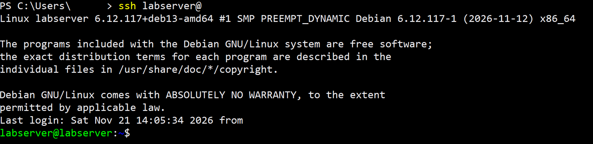
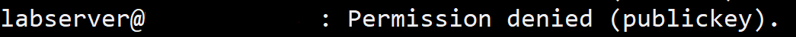

# 03 – SSH hardening

**Goal:** SSH access with keys only; no password logins and no root login.

**Why:** password guessing and credential reuse are the most common ways into SSH servers. Keys remove that whole attack path.

## 1. Create a key pair (on my main laptop)

```powershell
ssh-keygen -t ed25519
```

## 2. Install the public key on the server

```powershell
type $env:USERPROFILE\.ssh\id_ed25519.pub | ssh <user>@<server-lan-ip> "mkdir -p ~/.ssh && chmod 700 ~/.ssh && cat >> ~/.ssh/authorized_keys && chmod 600 ~/.ssh/authorized_keys"
```

Test with a fresh `ssh <user>@<server-lan-ip>`; it should not ask for the account password.



## 3. Disable passwords and root login

In `/etc/ssh/sshd_config`:

```
PasswordAuthentication no
PermitRootLogin no
```

```bash
sudo sshd -t                 # config syntax check
sudo systemctl reload ssh
sudo sshd -T | grep -E 'passwordauthentication|permitrootlogin'
```

I kept the existing session open and tested a second login before closing anything, so a mistake could not lock me out.

> **TODO (evidence):** `screenshots/08-sshd-effective-config.png` (both lines should say `no`).

## 4. Prove passwords are rejected

```powershell
ssh -o PreferredAuthentications=password <user>@<server-lan-ip>
# expect: Permission denied (publickey)
```


## Further hardening after the Lynis audit

The audit (see [doc 06](06-lynis-audit.md)) flagged more SSH settings, which I applied in `sshd_config`:

```
AllowTcpForwarding no
AllowAgentForwarding no
X11Forwarding no
TCPKeepAlive no
ClientAliveCountMax 2
LogLevel VERBOSE
MaxAuthTries 3
MaxSessions 2
```

`fail2ban` is also installed to ban addresses with repeated failed logins. The only SSH suggestion left is changing the port, which I accepted: SSH is reachable only over the VPN, so a different port adds little.

## Host key verification

After reinstalling the OS, SSH warned that the host key had changed. I did not just delete the entry: I compared the fingerprint on the server's own console with the one in the warning, then removed the stale entry. Details in [troubleshooting](troubleshooting.md).

## What this does and doesn't protect against

- Protects against: password brute force and credential stuffing over SSH.
- Doesn't protect against: a stolen private key (mitigated by a key passphrase), or compromise of my main laptop.

## What I'd do differently

- Put the whole SSH hardening set in one drop-in file under `/etc/ssh/sshd_config.d/` from the start, so it can be committed to `configs/` and re-applied after a reinstall.
- Record the host-key fingerprint at install time (see doc 02).
