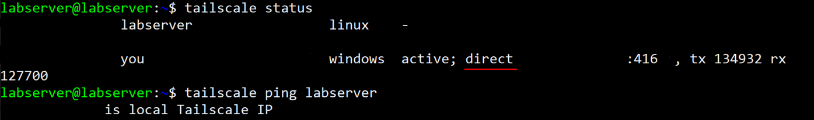

# 04 – Tailscale VPN

**Goal:** reach the server securely from anywhere without opening any port on the home router.

**Why:** port forwarding exposes a service to the whole internet, and many home connections can't forward ports at all. Tailscale builds an encrypted WireGuard-based overlay network instead.

## Install and join

On the server:

```bash
curl -fsSL https://tailscale.com/install.sh | sh
sudo tailscale up
```

Open the login URL on another device, then install Tailscale on my main laptop and sign in with the same account.

```bash
tailscale ip -4        # the server's 100.x.x.x address
```

For an always-on server, I disabled key expiry for this machine in the Tailscale admin console.

## Test from outside the home network

Main laptop on a phone hotspot:

```powershell
ssh <user>@<tailscale-ip>
```

> **TODO (evidence):** `screenshots/12-hotspot-ssh-test.png` (redact addresses).

## Direct vs relayed

At home, traffic between two devices on the same LAN should go directly, not through the internet:

```powershell
tailscale status
tailscale ping <server-name>     # "via 192.168.x.x" = direct, "via DERP" = relayed
```



Run `tailscale ping` from the *other* device. Run on the server itself, it pings itself and only prints "is local Tailscale IP". The `direct` shown by `tailscale status` is the evidence that traffic stays on the home network.

## Tailscale and ufw

Tailscale on Linux accepts traffic arriving on the `tailscale0` interface before ufw's rules are evaluated, so ufw does not filter tailnet traffic by default ([Tailscale netfilter modes](https://tailscale.com/docs/reference/netfilter-modes)). I found this by scanning my own server twice (details in [doc 05](05-firewall.md)): from the home network, ports 80 and 443 were `filtered` (dropped by ufw), but over Tailscale they were `closed` (the packets reached the host).

What this means:

- The `allow in on tailscale0 ... port 22` rule is harmless but redundant.
- Any service I run later is reachable by every device on my tailnet, whatever ufw says. Each service needs its own authentication, and Tailscale ACLs should limit which devices and users can reach which ports.


## Trade-offs

- Relies on Tailscale's coordination service (traffic itself is end-to-end encrypted).
- Every device needs the app.
- Future options: raw WireGuard on the server, or self-hosting a coordination server.

## Next

> **TODO:** write Tailscale access rules (ACLs) so each device and family member can reach only what they need, before inviting family to the tailnet.

## What I'd do differently

- Plan ACLs from the start. The default lets every device on the tailnet reach every port on the server, and ufw can't change that.
- Run `tailscale ping` from the client, not from the server.
