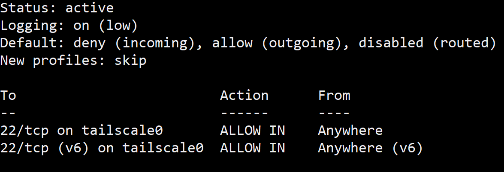
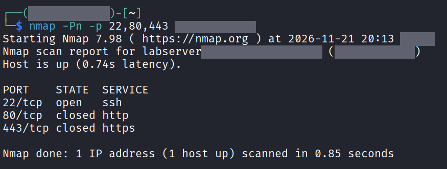

# 05 – Firewall with ufw

**Goal:** drop all inbound traffic except SSH over the VPN.

**Why:** default-deny means a service I forget about is not exposed by accident.

## Rules

```bash
sudo ufw default deny incoming
sudo ufw default allow outgoing
sudo ufw allow in on tailscale0 to any port 22 proto tcp
sudo ufw allow from <lan-subnet> to any port 22 proto tcp   # temporary safety net
sudo ufw enable
sudo ufw status verbose
```

| Rule | Purpose |
|---|---|
| default deny incoming | Baseline: anything not explicitly allowed is dropped |
| default allow outgoing | Updates and the VPN need to reach out; replies are allowed automatically |
| allow on `tailscale0`, port 22/tcp | SSH only through the VPN interface |
| allow from LAN, port 22/tcp | Temporary, in case the VPN rule failed during testing |
| allow from LAN, port 80/tcp | Family Hub page (nginx + Homer), home network only |
| allow on `tailscale0`, port 80/tcp | Hub over the VPN (redundant, see the finding below) |
| allow from LAN, port 3923/tcp | Family file drive (copyparty), home network only |

Once SSH over Tailscale was proven (including from a phone hotspot), I removed the temporary LAN rule:

```bash
sudo ufw status numbered
sudo ufw delete <rule-number>
```


## Verify

On the server:

```bash
sudo ss -tulpn
```

> **TODO (evidence):** `screenshots/14-listening-ports.png`.

From my main laptop on the home Wi-Fi, scanning my own server:

```powershell
nmap -Pn -p 22,80,443 <server-lan-ip>
```

| Test                         | Expected              | Result   |
| ---------------------------- | --------------------- | -------- |
| SSH via LAN address          | Times out / filtered  | filtered |
| SSH via Tailscale address    | Works                 | open     |
| nmap against the LAN address | Ports show `filtered` | filtered |

> **Nmap from lan:** 


> **Nmap over Tailscale:** 

## Finding: Tailscale accepts traffic before ufw

The two scans above differ for a reason. From the home network, ports 80 and 443 are `filtered`: ufw drops the packets silently. Over Tailscale they are `closed`: the packets reach the host and nothing is listening. Tailscale on Linux accepts traffic arriving on `tailscale0` before ufw's rules are evaluated ([Tailscale netfilter modes](https://tailscale.com/docs/reference/netfilter-modes)), so ufw never sees it.

Consequences:

- The `tailscale0` allow rules are harmless but redundant. The LAN rules are the ones doing the work.
- Every service on the server is reachable by every device on my tailnet. Each service needs its own authentication, and Tailscale ACLs should restrict who can reach which port (see [doc 04](04-tailscale.md)).

To confirm on the server:

```bash
sudo iptables -S ts-input     # look for: -i tailscale0 -j ACCEPT
```

> **TODO (evidence):** paste the output here.

## Re-scan after adding services

The scans above were taken before the Hub and the file drive existed. After adding them:

| Test | Expected | Result |
|---|---|---|
| `nmap -Pn -p 22,80,443,3923 <server-lan-ip>` from the home network | 22 and 443 `filtered`; 80 and 3923 `open` | TODO |
| Same scan against the Tailscale address | 22, 80 and 3923 `open`; 443 `closed` | TODO |

## Notes

- Only scan machines I own.
- Services added later each get their own narrowly scoped rule: the Hub (80) and the file drive (3923) are allowed from the home network only. The rule set is saved in [`configs/ufw-rules.sh`](../configs/ufw-rules.sh).

## What I'd do differently

- Learn the Tailscale/ufw behavior before designing the rules. I wrote `tailscale0` rules first and only discovered from the scans that they do nothing.
- Re-scan after every service I add, and keep the results in this table.
