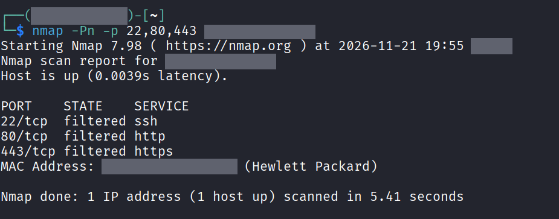

# 05 – Firewall with ufw

**Goal:** drop all inbound traffic except SSH over the VPN.

**Why:** default-deny means a service I forget about is not exposed by accident.

## Rules

```bash
sudo ufw default deny incoming
sudo ufw default allow outgoing
sudo ufw allow in on tailscale0 to any port 22 proto tcp
sudo ufw allow from <lan-subnet> to any port 22 proto tcp   # temporary safety net
sudo ufw enable
sudo ufw status verbose
```

| Rule | Purpose |
|---|---|
| default deny incoming | Baseline: anything not explicitly allowed is dropped |
| default allow outgoing | Updates and the VPN need to reach out; replies are allowed automatically |
| allow on `tailscale0`, port 22/tcp | SSH only through the VPN interface |
| allow from LAN, port 22/tcp | Temporary, in case the VPN rule failed during testing |

Once SSH over Tailscale was proven (including from a phone hotspot), I removed the temporary LAN rule:

```bash
sudo ufw status numbered
sudo ufw delete <rule-number>
```


## Verify

On the server:

```bash
sudo ss -tulpn
```

> **TODO (evidence):** `screenshots/14-listening-ports.png`.

From my main laptop on the home Wi-Fi, scanning my own server:

```powershell
nmap -Pn -p 22,80,443 <server-lan-ip>
```

| Test                         | Expected              | Result   |
| ---------------------------- | --------------------- | -------- |
| SSH via LAN address          | Times out / filtered  | filtered |
| SSH via Tailscale address    | Works                 | open     |
| nmap against the LAN address | Ports show `filtered` | filtered |

> **Nmap from lan:** 


> **Nmap over Tailscale:** 

## Notes

- Only scan machines I own.
- Services added later (web page, file sharing) each get their own narrowly scoped rule.
- Save the final rules as `configs/ufw-rules.sh` with placeholders for addresses.

## What I'd do differently

> **TODO:** one or two lines.
