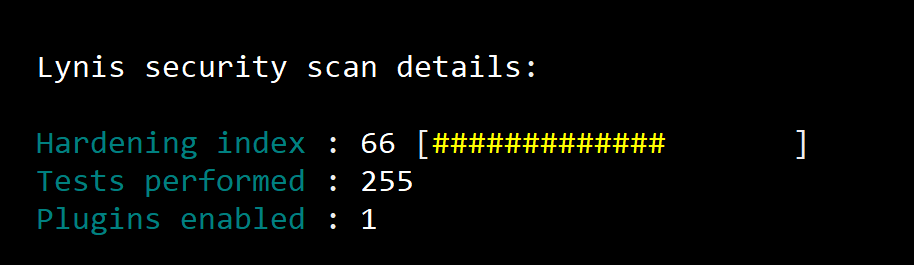
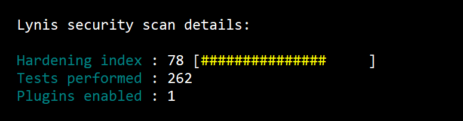

# 06 – Lynis security audit

**Goal:** measure the server's hardening objectively, fix what matters, and show the improvement.

**Why:** "I hardened it" is a claim; a before/after score with reasons is evidence.

## Run the audit

```bash
sudo apt install -y lynis
sudo lynis audit system
sudo grep hardening_index /var/log/lynis-report.dat
sudo grep -E "^(warning|suggestion)\[\]" /var/log/lynis-report.dat
```

Don't publish the full report: it can contain hostnames and addresses.

## Scores

| Run                        | Hardening index | Date       |
| -------------------------- | --------------- | ---------- |
| Baseline (before changes)  | 66              | 21/11/2026 |
| After first round of fixes | 78              | 23/11/2026 |
| After fixes                | TODO            | TODO       |

> **Lynis score (before):** 

> **Lynis score (after):** 

## Findings and decisions

| Finding                                                                                                                                                                                                                                                                                                                                                                                                          | Decision       | Why                                                                                                                                                                                | Fix                                                                                                                         |
| ---------------------------------------------------------------------------------------------------------------------------------------------------------------------------------------------------------------------------------------------------------------------------------------------------------------------------------------------------------------------------------------------------------------- | -------------- | ---------------------------------------------------------------------------------------------------------------------------------------------------------------------------------- | --------------------------------------------------------------------------------------------------------------------------- |
| `HRDN-7230` Install at least one malware scanner                                                                                                                                                                                                                                                                                                                                                                 | Fixed          | Cheap rootkit and file-change detection for a small server. ClamAV added later for the family file share                                                                           | `sudo apt install rkhunter`, then `sudo rkhunter --propupd`                                                                 |
| `LYNIS` This release is more than 4 months old. Check the website or GitHub to see if there is an update available                                                                                                                                                                                                                                                                                               | Fixed          | updating the auditing tool will give me more updated suggestions and warning to fix and more focused Hardening.                                                                    | `sudo apt update && sudo apt install --only-upgrade lynis` then <br>`sudo apt upgrade lynis`                                |
| `DEB-0880` Install fail2ban to automatically ban hosts that commit multiple authentication errors.<br><br>`DEB-0880`Copy /etc/fail2ban/jail.conf to jail.local to prevent it being changed by updates.                                                                                                                                                                                                           | Fixed          | Learning more about how to handle authentication attempts from ouside source attacking the server                                                                                  | `sudo apt install fail2ban`<br><br>`sudo cp /etc/fail2ban/jail.conf /etc/fail2ban/jail.local`                               |
| `SSH-7408` Consider hardening SSH configuration<br><br>AllowTcpForwarding (set YES to NO)<br><br>ClientAliveCountMax (set 3 to 2)<br><br>AllowTcpForwarding (set YES to NO)<br><br>LogLevel (set INFO to VERBOSE)<br><br>X11Forwarding (set YES to NO)<br><br>TCPKeepAlive (set YES to NO)<br><br>AllowAgentForwarding (set YES to NO)<br><br>MaxAuthTries (set 6 to 3)<br><br>MaxSessions (set 10 to 2)<br><br> | Fixed          |                                                                                                                                                                                    |                                                                                                                             |
| `SSH-7408`Consider hardening SSH configuration <br>Port (set 22 to )                                                                                                                                                                                                                                                                                                                                             | Accepted       | `Port` is the only item left in this finding. SSH is reachable only over Tailscale, so changing the port is obscurity                                                              | None                                                                                                                        |
| `DEB-0280` Install libpam-tmpdir to set $TMP and $TMPDIR for PAM sessions                                                                                                                                                                                                                                                                                                                                        | Fixed          |                                                                                                                                                                                    |                                                                                                                             |
| `NETW-3200` Protocols dccp, sctp, rds, tipc                                                                                                                                                                                                                                                                                                                                                                      | Fixed          | Rarely used protocols; each loadable module is extra kernel attack surface and nothing here needs them                                                                             | `sudo tee /etc/modprobe.d/disable-rare-protocols.conf >/dev/null <<'EOF'`<br>`>install <Protocol-Name> /bin/true` <br>`EOF` |
| `STRG-1846` FireWire storage                                                                                                                                                                                                                                                                                                                                                                                     | Fixed          | No FireWire devices in use; stops the driver from loading                                                                                                                          | `install firewire-core /bin/true` and `install firewire-ohci /bin/true` in `/etc/modprobe.d/` Like in `NETW-3200`           |
| `PKGS-7370` Install debsums                                                                                                                                                                                                                                                                                                                                                                                      | Fixed          | Verifies installed package files against their checksums to detect tampering\|                                                                                                     | `sudo apt install debsums`, then `sudo debsums -s`                                                                          |
| `PKGS-7394` Install apt-show-versions                                                                                                                                                                                                                                                                                                                                                                            | Fixed          | Shows which packages have updates available; complements unattended-upgrades                                                                                                       | `sudo apt install apt-show-versions`                                                                                        |
| `AUTH-9262` Password strength module                                                                                                                                                                                                                                                                                                                                                                             | Fixed          | The sudo password is the last barrier once someone has a shell, so it should be strong\|                                                                                           | `sudo apt install libpam-passwdqc`                                                                                          |
| `BANN-7126`, `BANN-7130` Login banners                                                                                                                                                                                                                                                                                                                                                                           | Fixed          | Standard practice, and it replaces the default banner that discloses the OS and version\|                                                                                          | Replace `/etc/issue` and `/etc/issue.net` with a short authorized-use notice                                                |
| `ACCT-9626` sysstat                                                                                                                                                                                                                                                                                                                                                                                              | Fixed          | Keeps CPU, memory and disk history (`sar`), useful as evidence for the idle-vs-Kali comparison\|                                                                                   | `sudo apt install sysstat`; set `ENABLED="true"` in `/etc/default/sysstat`                                                  |
| `ACCT-9628` auditd                                                                                                                                                                                                                                                                                                                                                                                               | Fixed          | Kernel-level audit trail of logins, privilege use and file changes; good SOC practice and a source for the SIEM\|                                                                  | `sudo apt install auditd`                                                                                                   |
| `LOGG-2190` Deleted files still in use                                                                                                                                                                                                                                                                                                                                                                           | Fixed          | Usually libraries replaced by updates but still held by running services                                                                                                           | Reboot or restart the listed services, then re-audit                                                                        |
| `FILE-7524` File permissions                                                                                                                                                                                                                                                                                                                                                                                     | TODO           | Lynis lists specific files that are more permissive than its baseline                                                                                                              | Find them with `sudo lynis audit system --tests FILE-7524`, then `chmod` each                                               |
| `HRDN-7222` Compilers                                                                                                                                                                                                                                                                                                                                                                                            | TODO           | A compiler on a server helps an attacker build tools, and this server does not need one                                                                                            | `command -v gcc cc g++ c++ as`; remove what isn't needed, otherwise restrict to root                                        |
| `LYNIS` Release more than 4 months old                                                                                                                                                                                                                                                                                                                                                                           | Accepted       | Using the Debian-packaged version keeps before/after scores comparable; a newer version adds tests that change the score                                                           | Revisit at the next full audit                                                                                              |
| `BOOT-5122` GRUB password                                                                                                                                                                                                                                                                                                                                                                                        | Accepted       | Physical access is outside the threat model (home server, disk intentionally unencrypted so it reboots unattended). A mistake in GRUB on a headless box risks an unbootable server | None                                                                                                                        |
| `BOOT-5180` Runlevel and startup services                                                                                                                                                                                                                                                                                                                                                                        | Accepted       | Informational. Startup services are reviewed with `systemctl list-unit-files --state=enabled`                                                                                      | None                                                                                                                        |
| `BOOT-5264` systemd service hardening                                                                                                                                                                                                                                                                                                                                                                            | Planned        | Follow-up: use `systemd-analyze security` to harden `nginx` and other services with drop-ins, checking nothing breaks                                                              | None Yet                                                                                                                    |
| `AUTH-9230` Password hashing rounds                                                                                                                                                                                                                                                                                                                                                                              | Not applicable | The setting applies to SHA-crypt hashes; Debian 13 hashes passwords with yescrypt by default                                                                                       | Verify: `grep ENCRYPT_METHOD /etc/login.defs`                                                                               |
| `AUTH-9282` Account expiry dates                                                                                                                                                                                                                                                                                                                                                                                 | Accepted       | One admin account on a personal server, so expiry adds no value                                                                                                                    | None                                                                                                                        |
| `AUTH-9286` Minimum and maximum password age                                                                                                                                                                                                                                                                                                                                                                     | Accepted       | The password is only used for sudo (SSH is key-only), and forced rotation is no longer recommended                                                                                 | None                                                                                                                        |
| `AUTH-9328` Default umask                                                                                                                                                                                                                                                                                                                                                                                        | Accepted       | A stricter umask (027) could break access for future services (web, file share); revisit when the file share is designed                                                           | None                                                                                                                        |
| `FILE-6310` Separate `/home` and `/var` partitions                                                                                                                                                                                                                                                                                                                                                               | Not applicable | Single small disk; repartitioning means reinstalling for little benefit                                                                                                            | None                                                                                                                        |
| `USB-1000` Disable USB storage                                                                                                                                                                                                                                                                                                                                                                                   | Accepted       | A USB drive is planned for backups, and physical access is out of scope                                                                                                            | None                                                                                                                        |
| `FIRE-4513` Unused iptables rules                                                                                                                                                                                                                                                                                                                                                                                | Accepted       | Rule set is minimal (ufw defaults plus one SSH rule, and Tailscale's own chains); reviewed                                                                                         | `sudo iptables -L -n -v`                                                                                                    |
| `TOOL-5002` Automation tools                                                                                                                                                                                                                                                                                                                                                                                     | Not applicable | Single host. Stretch idea: an Ansible playbook that rebuilds this server                                                                                                           | None                                                                                                                        |
| `LOGG-2154` External log host                                                                                                                                                                                                                                                                                                                                                                                    | Planned        | Logs will be forwarded to the SIEM in the Wazuh or Splunk project                                                                                                                  | None yet                                                                                                                    |
| `FINT-4350` File integrity tool                                                                                                                                                                                                                                                                                                                                                                                  | Planned        | Wazuh file integrity monitoring in the SIEM project (AIDE if needed sooner)                                                                                                        | None yet                                                                                                                    |

Not every suggestion fits a small VPN-only server; the point is to make a reasoned decision for each one I act on or skip.

## Monthly re-audit

Re-run Lynis monthly and add the new score above to show the trend.

## What I'd do differently

> **TODO:** one or two lines.
